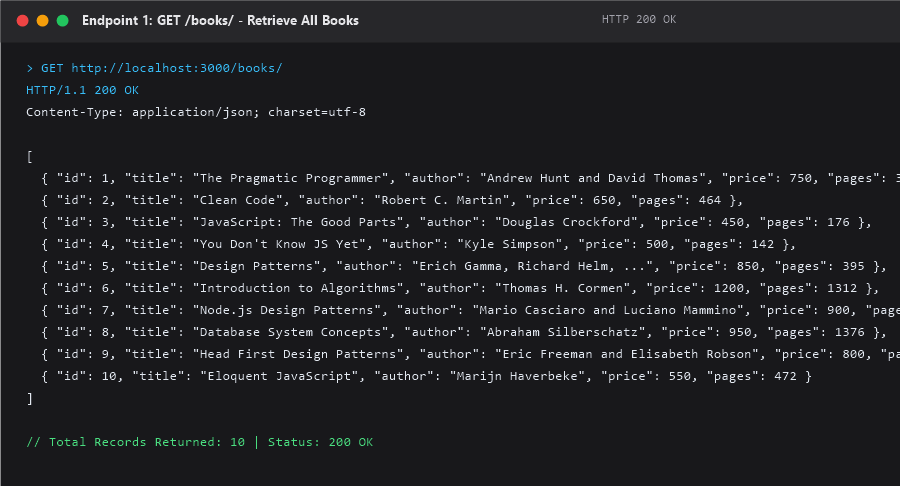
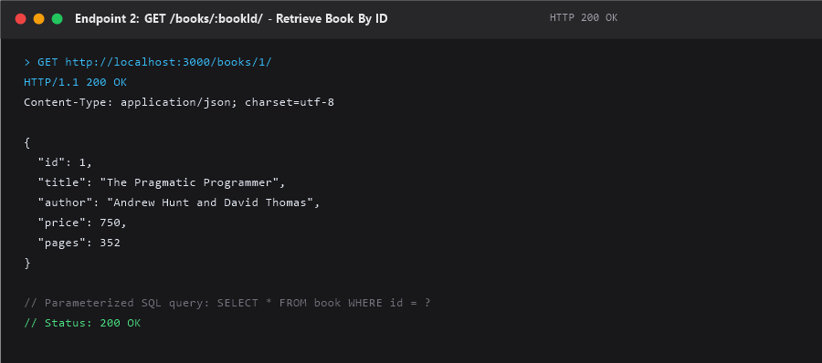
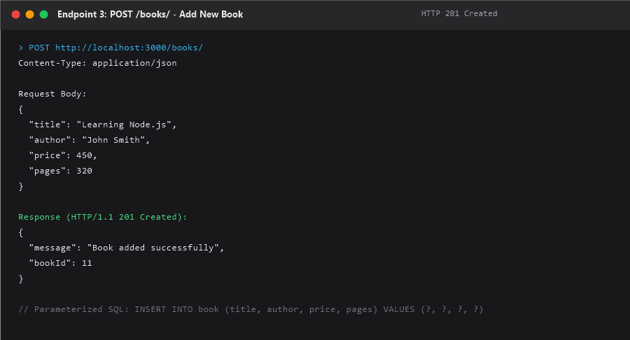
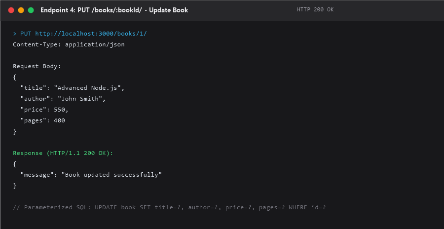
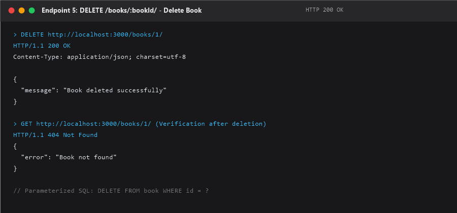
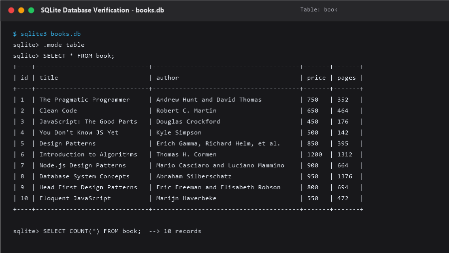

# Lab 02: SQLite Database and CRUD Routes

> **Live Link:** Not deployed yet.

---

## 1. Student Details

| Field | Details |
| :--- | :--- |
| **Student Name** | Reddy Mahitha |
| **Registration Number** | 252U1R3079 |
| **Section** | CSE-DS-2B |
| **Lab Number** | 02 |
| **Lab Title** | SQLite Database and CRUD Routes |
| **Default Port** | 3000 |

---

## 2. Objective

The objective of this laboratory assignment is to:
1. Set up an Express.js backend server integrated with an SQLite relational database using the `sqlite` and `sqlite3` driver libraries.
2. Initialize the SQLite database connection asynchronously using `async/await` before starting the HTTP server.
3. Design and create the `book` table and seed 10 initial sample records without duplicating data across server restarts.
4. Implement full RESTful CRUD (Create, Read, Update, Delete) API endpoints conforming to standard HTTP methods and status codes.
5. Prevent SQL Injection vulnerabilities by utilizing parameterized queries with `?` placeholders.
6. Implement robust request validation and error handling for malformed input or missing resources.
7. Test and verify all endpoints using Postman and inspect SQLite database tables.

---

## 3. Technologies Used

- **Node.js (v24.x)**: Asynchronous, event-driven JavaScript runtime engine.
- **Express.js (v5.x)**: Fast, minimalist web framework for building RESTful APIs.
- **SQLite3**: Serverless, self-contained, server-independent relational database engine stored in a local `.db` file.
- **sqlite (v5.x)**: Modern Promise-based wrapper around SQLite3 for clean `async/await` syntax.
- **nodemon**: Development monitoring utility that automatically restarts the server when source code changes.
- **Postman**: API testing suite for testing HTTP requests, payloads, headers, and responses.

---

## 4. Project Description

This project provides a clean, production-ready RESTful API for managing a library catalogue. All book records are stored inside a persistent SQLite database file named `books.db` inside the `lab-02` directory.

The application starts by calling `initializeDBAndServer()`. This function establishes a database connection, creates the `book` table if it does not exist, checks if sample data is needed, and only starts the Express server once the database is fully operational. Each endpoint uses parameterized queries to guarantee database integrity and security against SQL injection attacks.

---

## 5. Database Schema

The database file `books.db` contains a single table named `book`.

### Table: `book`

| Column Name | Data Type | Constraints | Description |
| :--- | :--- | :--- | :--- |
| `id` | `INTEGER` | `PRIMARY KEY AUTOINCREMENT` | Unique identifier for each book record |
| `title` | `TEXT` | `NOT NULL` | Title of the book |
| `author` | `TEXT` | `NOT NULL` | Author name |
| `price` | `INTEGER` | `NOT NULL` | Price of the book in INR (positive number) |
| `pages` | `INTEGER` | `NOT NULL` | Total number of pages (positive integer) |

### DDL SQL Statement:
```sql
CREATE TABLE IF NOT EXISTS book (
    id INTEGER PRIMARY KEY AUTOINCREMENT,
    title TEXT,
    author TEXT,
    price INTEGER,
    pages INTEGER
);
```

### Initial Seed Data (10 Books):
1. *The Pragmatic Programmer* by Andrew Hunt and David Thomas (Price: 750, Pages: 352)
2. *Clean Code* by Robert C. Martin (Price: 650, Pages: 464)
3. *JavaScript: The Good Parts* by Douglas Crockford (Price: 450, Pages: 176)
4. *You Don't Know JS Yet* by Kyle Simpson (Price: 500, Pages: 142)
5. *Design Patterns* by Erich Gamma, Richard Helm, Ralph Johnson, John Vlissides (Price: 850, Pages: 395)
6. *Introduction to Algorithms* by Thomas H. Cormen (Price: 1200, Pages: 1312)
7. *Node.js Design Patterns* by Mario Casciaro and Luciano Mammino (Price: 900, Pages: 664)
8. *Database System Concepts* by Abraham Silberschatz (Price: 950, Pages: 1376)
9. *Head First Design Patterns* by Eric Freeman and Elisabeth Robson (Price: 800, Pages: 694)
10. *Eloquent JavaScript* by Marijn Haverbeke (Price: 550, Pages: 472)

*(The complete SQL commands are also saved separately in `database.sql`)*.

---

## 6. Installation Instructions

1. Open your terminal and navigate to the `lab-02` folder:
   ```bash
   cd lab-02
   ```

2. Install all required production and development dependencies:
   ```bash
   npm install
   ```

   This installs:
   - `express`
   - `sqlite`
   - `sqlite3`
   - `nodemon` (as dev dependency)

---

## 7. How to Run

### Development Mode (with automatic restart via nodemon):
```bash
npm run dev
```

### Production Mode (standard Node.js execution):
```bash
npm start
```

When started, the terminal displays:
```text
Connected to SQLite database successfully.
Server is running at http://localhost:3000/
```

---

## 8. Required Environment Variables

| Variable | Required? | Default Value | Description |
| :--- | :--- | :--- | :--- |
| `PORT` | Optional | `3000` | Port on which the HTTP Express server listens |

> **Note:** The default port is `3000`. No `.env` file is required for local execution unless custom port configuration is desired.

---

## 9. API Endpoints Table

| # | HTTP Method | Endpoint Route | Description | Success Status | Error Statuses |
| :-: | :--- | :--- | :--- | :-: | :-: |
| 1 | `GET` | `/books/` | Retrieve all books from database | `200 OK` | `500 Internal Server Error` |
| 2 | `GET` | `/books/:bookId/` | Retrieve a single book by its ID | `200 OK` | `400 Bad Request`, `404 Not Found` |
| 3 | `POST` | `/books/` | Add a new book to the database | `201 Created` | `400 Bad Request`, `500 Internal Server Error` |
| 4 | `PUT` | `/books/:bookId/` | Update an existing book's details | `200 OK` | `400 Bad Request`, `404 Not Found` |
| 5 | `DELETE` | `/books/:bookId/` | Remove a book from the database | `200 OK` | `400 Bad Request`, `404 Not Found` |

---

## 10. HTTP Status Codes Used

- `200 OK`: Request succeeded (used for GET all, GET by ID, PUT update, and DELETE).
- `201 Created`: Resource successfully created (used for POST add book).
- `400 Bad Request`: Client sent invalid or missing data (e.g., negative price, empty title, non-integer ID).
- `404 Not Found`: Requested resource does not exist (e.g., non-existent book ID).
- `500 Internal Server Error`: Unexpected server-side failure.

---

## 11. Example Request Bodies & Responses

### 1. `GET /books/`
- **Request Body:** None
- **Response Status:** `200 OK`
- **Response Body:**
  ```json
  [
    {
      "id": 1,
      "title": "The Pragmatic Programmer",
      "author": "Andrew Hunt and David Thomas",
      "price": 750,
      "pages": 352
    },
    ...
  ]
  ```

### 2. `GET /books/1/`
- **Request Body:** None
- **Response Status:** `200 OK`
- **Response Body:**
  ```json
  {
    "id": 1,
    "title": "The Pragmatic Programmer",
    "author": "Andrew Hunt and David Thomas",
    "price": 750,
    "pages": 352
  }
  ```

### 3. `POST /books/`
- **Request Body:**
  ```json
  {
    "title": "Learning Node.js",
    "author": "John Smith",
    "price": 450,
    "pages": 320
  }
  ```
- **Response Status:** `201 Created`
- **Response Body:**
  ```json
  {
    "message": "Book added successfully",
    "bookId": 11
  }
  ```

### 4. `PUT /books/1/`
- **Request Body:**
  ```json
  {
    "title": "Advanced Node.js",
    "author": "John Smith",
    "price": 550,
    "pages": 400
  }
  ```
- **Response Status:** `200 OK`
- **Response Body:**
  ```json
  {
    "message": "Book updated successfully"
  }
  ```

### 5. `DELETE /books/1/`
- **Request Body:** None
- **Response Status:** `200 OK`
- **Response Body:**
  ```json
  {
    "message": "Book deleted successfully"
  }
  ```

---

## 12. SQL Injection Prevention

### What is SQL Injection?
SQL Injection (SQLi) is a security vulnerability where an attacker manipulates application SQL queries by injecting malicious SQL commands via user input fields (query params, route params, or JSON body).

### Dangerous Code (String Concatenation):
```javascript
// VULNERABLE: An attacker passing "1 OR 1=1" can read or wipe all records!
const query = `SELECT * FROM book WHERE id = ${req.params.bookId};`;
await db.get(query);
```

### Safe Code (Parameterized Queries with `?` Placeholders):
```javascript
// SECURE: User input is sent separately as bound parameters!
const query = 'SELECT * FROM book WHERE id = ?;';
await db.get(query, [req.params.bookId]);
```

### Why `?` Placeholders Prevent SQL Injection:
1. **Separation of Code and Data:** The database engine parses and compiles the SQL query structure *before* substituting the parameter values.
2. **Strict Type Treatment:** Values passed inside the array `[value1, value2]` are treated purely as literal data values, never as executable SQL statements. Even if the user inputs `' OR '1'='1`, the engine treats it as a literal string.

In this project, parameterized queries are strictly applied to all database operations:
- `SELECT * FROM book WHERE id = ?;`
- `INSERT INTO book (title, author, price, pages) VALUES (?, ?, ?, ?);`
- `UPDATE book SET title = ?, author = ?, price = ?, pages = ? WHERE id = ?;`
- `DELETE FROM book WHERE id = ?;`

---

## 13. Postman Testing & Verification

All five CRUD endpoints and edge cases were tested against the running server. A complete Postman collection is included in this repository: `postman_collection.json`.

### How to Import and Run the Postman Collection:
1. Open Postman.
2. Click **Import** (top left).
3. Select or drag-and-drop `lab-02/postman_collection.json`.
4. Ensure the server is running (`npm run dev`).
5. Run the requests in order:
   - `1. GET All Books` -> Verifies 10 initial records.
   - `2. GET Book by ID (ID: 1)` -> Verifies single book lookup.
   - `3. POST Add New Book` -> Adds new book, receives status `201` and `bookId: 11`.
   - `4. PUT Update Book (ID: 1)` -> Updates book 1, receives status `200`.
   - `5. DELETE Book by ID (ID: 1)` -> Removes book 1, receives status `200`.
   - `6. GET Non-Existent Book (404 Error Test)` -> Verifies `404 Not Found`.
   - `7. GET Invalid ID Format (400 Error Test)` -> Verifies `400 Bad Request`.
   - `8. POST Validation Failure (400 Error Test)` -> Verifies `400 Bad Request`.

---

## 14. SQLite Database Verification

Database records can be verified using the SQLite CLI or visual tools.

### Commands for SQLite CLI:
```bash
# Open database file in SQLite CLI
sqlite3 books.db

# Enable table formatting
sqlite> .mode table

# Retrieve all books
sqlite> SELECT * FROM book;

# Count total books
sqlite> SELECT COUNT(*) FROM book;

# Retrieve specific book
sqlite> SELECT * FROM book WHERE id = 1;

# Exit SQLite CLI
sqlite> .quit
```

### Alternative SQLite Viewers:
If the `sqlite3` CLI tool is not installed globally on your machine:
1. **VS Code Extension:** Install the **SQLite Viewer** or **SQLite** extension by Florian Klampfer in VS Code, then click on `books.db` to visually view tables and rows.
2. **DB Browser for SQLite:** Download the free GUI tool from [sqlitebrowser.org](https://sqlitebrowser.org/) to open `books.db`.

---

## 15. Screenshots

### Endpoint 1: GET All Books


### Endpoint 2: GET Book by ID


### Endpoint 3: POST Add New Book


### Endpoint 4: PUT Update Book


### Endpoint 5: DELETE Book by ID


### SQLite Database Verification


---

## 16. Problems Faced and Solutions

1. **Problem:** Asynchronous race condition where Express routes receive incoming HTTP traffic before the SQLite database file is opened.
   - **Solution:** Implemented `initializeDBAndServer()` as an `async` function. The call to `app.listen()` is placed inside the `try` block only *after* `await open(...)` resolves successfully.

2. **Problem:** Inserting sample seed records on every server restart caused duplicate book entries.
   - **Solution:** Added a check `SELECT COUNT(*) AS count FROM book;`. The seed `INSERT` queries only execute if the count is strictly `0`.

3. **Problem:** Vulnerability to SQL Injection when inserting or filtering records with dynamic user input.
   - **Solution:** Replaced all string template interpolations with parameterized queries using `?` placeholders and parameters arrays.

4. **Problem:** Invalid request payloads (negative numbers, empty strings, missing fields) dirtying the database.
   - **Solution:** Created helper validation functions (`validateBookBody` and `isValidPositiveInteger`) that validate input types and values and return explicit `400 Bad Request` messages before any database query executes.

---

## 17. Deployment Considerations (Render / Railway)

- **Port Binding:** The server dynamically listens to `process.env.PORT || 3000`. This enables cloud platforms (like Render or Railway) to assign their dynamic port.
- **SQLite Persistence Limitation:** SQLite is a local file-based database (`books.db`). Modern containerized platforms like Render and Railway use ephemeral file systems: any file written to disk is discarded whenever the container restarts or redeploys.
- **Solution for Production Persistence:** To use SQLite in production on Render or Railway, a **Persistent Disk / Volume** must be mounted to the container directory holding `books.db`. Alternatively, production systems often migrate to managed client-server databases like PostgreSQL or MySQL.

---

## 18. Conclusion

This lab demonstrated end-to-end backend development using Node.js, Express.js, and SQLite. By structuring asynchronous database initialization, implementing parameterized SQL queries, adhering to REST conventions, and implementing robust input validation, we built a reliable, secure, and persistent CRUD web service.

---

## 19. Viva Questions and Answers

### Q1: What is the purpose of each file in the project?
- `server.js`: The central Express application file containing database initialization, route definitions, input validation, and server listening logic.
- `books.db`: The SQLite binary database file storing the `book` table and records.
- `database.sql`: Raw SQL file containing DDL (`CREATE TABLE`) and DML (`INSERT`) statements for standalone execution and database setup.
- `package.json`: Project manifest listing metadata, scripts (`start`, `dev`), and dependencies (`express`, `sqlite`, `sqlite3`, `nodemon`).
- `postman_collection.json`: Standardized export file containing all pre-configured API requests for easy testing in Postman.
- `.gitignore`: Specifies files and directories that Git should ignore (`node_modules/`, `.env`).
- `README.md`: Comprehensive documentation covering architecture, setup, testing, and viva preparation.

### Q2: How does the Express server connect to SQLite?
The server uses the `open()` function from the `sqlite` package along with the `sqlite3.Database` driver. It specifies the file path `path.join(__dirname, 'books.db')`. When called, `open()` returns a Promise that resolves to an active database connection object, which is saved in the global `db` variable.

### Q3: Why does `initializeDBAndServer()` use `async/await`?
Opening a database connection and executing table creation queries are asynchronous I/O operations that take time. Using `async/await` ensures JavaScript waits for the database connection and table creation to succeed before calling `app.listen()`. This eliminates race conditions where incoming HTTP requests arrive before the database is ready.

### Q4: What does CRUD mean?
CRUD stands for the four foundational operations of persistent storage:
- **C**reate: Adding new records (`POST` -> `INSERT`)
- **R**ead: Querying existing records (`GET` -> `SELECT`)
- **U**pdate: Modifying existing records (`PUT` -> `UPDATE`)
- **D**elete: Removing records (`DELETE` -> `DELETE`)

### Q5: How do GET, POST, PUT, and DELETE work?
- `GET`: Retrieves data from the server without modifying state (safe and idempotent).
- `POST`: Submits new data to the server to create a new resource.
- `PUT`: Replaces or updates an existing resource identified by a unique ID (idempotent).
- `DELETE`: Removes the specified resource from the database (idempotent).

### Q6: What is SQL Injection?
SQL Injection occurs when untrusted user input is directly concatenated into an SQL command string. An attacker can craft input containing SQL syntax (e.g. `' OR '1'='1`) to manipulate the query logic, bypass authentication, read unauthorized data, or delete tables.

### Q7: How do `?` placeholders prevent SQL Injection?
The `?` placeholder indicates a bound parameter in a prepared statement. The SQL query structure is compiled by the database engine first. The parameter values are passed separately and treated strictly as literal data, never as executable SQL commands.

### Q8: What is the difference between POST and PUT?
- `POST` creates a new resource. The server generates the resource ID (`lastID`). Repeated identical POST calls create multiple records.
- `PUT` modifies an existing resource at a specific URI (`/books/:bookId/`). Repeated identical PUT calls leave the resource in the exact same state (idempotent).

### Q9: Why is `nodemon` used in development?
Standard `node server.js` requires manually stopping and restarting the server every time a code change is made. `nodemon` monitors project files and automatically restarts the Node.js server upon saving changes, boosting developer productivity.

### Q10: How do you test the project using Postman?
1. Start the server using `npm run dev`.
2. Open Postman, click **Import**, and select `postman_collection.json`.
3. Set the base URL to `http://localhost:3000`.
4. Trigger requests for GET, POST, PUT, and DELETE.
5. Inspect the response body, HTTP status code (200, 201, 400, 404), and verify changes in `books.db`.

