# Lab 03: REST API, Query Parameters, Validation and Debugging

> **Live Deployment:** Not deployed. Local SQLite file-based persistence is not natively retained across ephemeral container restarts without persistent volume attachments on platforms such as Render or Railway.

---

## 1. Student Details

| Field | Details |
| :--- | :--- |
| **Student Name** | Reddy Mahitha |
| **Registration Number** | 252U1R3079 |
| **Section** | CSE-DS-2B |
| **Lab Number** | 03 |
| **Lab Title** | REST API, Query Parameters, Validation and Debugging |
| **Default Port** | 3000 |

---

## 2. Objective

The objective of this laboratory assignment is to:
1. Develop an independent, production-ready Express.js REST API integrated with an isolated SQLite relational database (`books.db`).
2. Implement advanced query parameter capabilities on `GET /books`:
   - Partial search via SQL `LIKE` (`search_q`)
   - Safe column sorting (`order_by`) and direction toggling (`order=ASC|DESC`) via strict identifier whitelisting
   - Server-side pagination using `limit` and `offset`
   - Range filtering using `min_price` and `max_price`
   - Multi-parameter filter combinations
3. Enforce strict input validation rules on `POST` and `PUT` request bodies to protect data integrity and reject malformed inputs with standard `400 Bad Request` responses.
4. Protect against SQL Injection vulnerabilities by strictly applying parameterized queries (`?` placeholders) and column whitelisting.
5. Study, simulate, and document four high-frequency backend debugging scenarios: `EADDRINUSE`, `MODULE_NOT_FOUND`, table name typos, and missing `await` statements.
6. Author an automated 20-request Postman test suite with test assertion scripts.

---

## 3. Technologies Used

- **Node.js (v24.x):** Asynchronous, event-driven JavaScript runtime engine.
- **Express.js (v5.x):** Minimalist web application framework for routing, middleware, and request/response orchestration.
- **SQLite3 (v6.x):** Lightweight, serverless, file-based relational database engine.
- **sqlite (v5.x):** Modern Promise-based abstraction wrapper for SQLite3 supporting `async/await`.
- **Nodemon (v3.x):** Development monitor utility that automatically restarts the Node.js runtime upon file modifications.
- **Postman:** API client platform for automated testing, request chaining, and HTTP assertions.

---

## 4. Project Folder Structure

```text
lab-03/
│
├── server.js                        # Primary Express server, DB initialization, and CRUD routes
├── package.json                     # Project manifest, dependencies, and execution scripts
├── package-lock.json                # Locked dependency tree
├── books.db                         # Independent SQLite database file containing book records
├── database.sql                     # SQL DDL table schema and DML seed queries
├── .gitignore                       # Ignores node_modules/ and .env
├── README.md                        # Complete Lab 03 documentation
│
├── screenshots/                     # Verified execution screenshots
│   ├── server-running.png
│   ├── get-all-books.png
│   ├── get-book-by-id.png
│   ├── search-results.png
│   ├── sorting-results.png
│   ├── pagination-results.png
│   ├── price-filtering.png
│   ├── post-book-success.png
│   ├── put-book-success.png
│   ├── delete-book-success.png
│   ├── validation-error-400.png
│   ├── not-found-error-404.png
│   └── sqlite-database-records.png
│
├── postman/                         # Automated Postman collection
│   └── Lab-03-API-Collection.json
│
└── debugging-exercises/             # Practical debugging modules
    ├── broken-server.js             # 4 intentionally broken runnable error demonstrations
    └── DEBUGGING.md                 # Root-cause analysis, fixes, and prevention guide
```

---

## 5. Database Schema & Description

The database file `books.db` inside `lab-03/` contains an independent table named `book`.

### Table: `book`

| Column Name | Data Type | Constraints | Description |
| :--- | :--- | :--- | :--- |
| `id` | `INTEGER` | `PRIMARY KEY AUTOINCREMENT` | Auto-generated unique identifier |
| `title` | `TEXT` | `NOT NULL` | Title of the book (non-empty string) |
| `author` | `TEXT` | `NOT NULL` | Author name (non-empty string) |
| `price` | `INTEGER` | `NOT NULL` | Book price in INR (positive number) |
| `pages` | `INTEGER` | `NULLABLE` | Total page count (positive integer) |

### DDL Schema (`database.sql`):
```sql
CREATE TABLE IF NOT EXISTS book (
    id INTEGER PRIMARY KEY AUTOINCREMENT,
    title TEXT NOT NULL,
    author TEXT NOT NULL,
    price INTEGER NOT NULL,
    pages INTEGER
);
```

### Initial Seed Records (10 Books):
1. *Java: The Complete Reference* by Herbert Schildt (Price: 650, Pages: 1248)
2. *Effective Java* by Joshua Bloch (Price: 550, Pages: 416)
3. *Clean Code: A Handbook of Agile Software Craftsmanship* by Robert C. Martin (Price: 700, Pages: 464)
4. *The Pragmatic Programmer* by Andrew Hunt and David Thomas (Price: 750, Pages: 352)
5. *JavaScript: The Good Parts* by Douglas Crockford (Price: 400, Pages: 176)
6. *You Don't Know JS: Scope & Closures* by Kyle Simpson (Price: 450, Pages: 142)
7. *Design Patterns: Elements of Reusable Object-Oriented Software* by Erich Gamma et al. (Price: 850, Pages: 395)
8. *Introduction to Algorithms* by Thomas H. Cormen (Price: 1200, Pages: 1312)
9. *Node.js Design Patterns* by Mario Casciaro and Luciano Mammino (Price: 900, Pages: 664)
10. *Head First Design Patterns* by Eric Freeman and Elisabeth Robson (Price: 800, Pages: 694)

---

## 6. Installation Commands

Navigate to the `lab-03` directory and install project dependencies:

```bash
cd lab-03
npm install
```

To install packages manually from scratch:
```bash
npm install express sqlite sqlite3
npm install --save-dev nodemon
```

---

## 7. How to Run the Server

### Development Mode (with automatic restart via nodemon):
```bash
npm run dev
```

### Production Mode:
```bash
npm start
```

### Expected Startup Output:
```text
Connected to Lab 03 SQLite database successfully.
Lab 03 Server is running at http://localhost:3000/
```

---

## 8. Environment Variables

The server dynamically binds to the port provided by the environment, defaulting to `3000`:

| Variable Name | Required? | Default | Description |
| :--- | :--- | :--- | :--- |
| `PORT` | Optional | `3000` | HTTP port on which the server listens |

*Example `.env` (optional, not committed):*
```env
PORT=3000
```

---

## 9. API Endpoints Table

| # | Method | Path | Description | Success Status | Error Statuses |
| :-: | :--- | :--- | :--- | :-: | :-: |
| 1 | `GET` | `/` | API description & available endpoints | `200 OK` | - |
| 2 | `GET` | `/books` | Retrieve all books (with search, sort, pagination, price filters) | `200 OK` | `400 Bad Request`, `500 Server Error` |
| 3 | `GET` | `/books/:bookId` | Retrieve a single book by ID | `200 OK` | `400 Bad Request`, `404 Not Found` |
| 4 | `POST` | `/books` | Create a new book with input validation | `201 Created` | `400 Bad Request`, `500 Server Error` |
| 5 | `PUT` | `/books/:bookId` | Update an existing book with input validation | `200 OK` | `400 Bad Request`, `404 Not Found` |
| 6 | `DELETE` | `/books/:bookId` | Delete an existing book by ID | `200 OK` | `400 Bad Request`, `404 Not Found` |

---

## 10. Query Parameters Explanation & Examples

The `GET /books` endpoint supports dynamic querying:

| Parameter | Type | Default | Description | Example |
| :--- | :--- | :--- | :--- | :--- |
| `search_q` | String | None | Case-insensitive partial title search using SQL `LIKE` | `/books?search_q=java` |
| `order_by` | String | `id` | Column to sort by: `id`, `title`, `author`, `price`, `pages` | `/books?order_by=price` |
| `order` | String | `ASC` | Sort order: `ASC` or `DESC` (case-insensitive) | `/books?order=DESC` |
| `limit` | Integer | `10` | Maximum number of records to return (must be > 0) | `/books?limit=5` |
| `offset` | Integer | `0` | Number of records to skip from beginning (must be >= 0) | `/books?offset=5` |
| `min_price`| Number | None | Return books with `price >= min_price` | `/books?min_price=500` |
| `max_price`| Number | None | Return books with `price <= max_price` | `/books?max_price=800` |

### Combined Filter Example:
```http
GET http://localhost:3000/books?search_q=java&order_by=price&order=ASC&limit=5&offset=0&min_price=100&max_price=1000
```
- Filters books whose titles contain `"java"`
- Restricts prices to between 100 and 1000
- Sorts results by price ascending
- Returns the first 5 records

---

## 11. Validation Rules

All validation occurs in the application layer before executing database queries:

1. **Title:**
   - Required.
   - Must be a string.
   - Cannot be empty or contain only whitespace.
   - Fails with: `{"message": "Title is required"}` (Status `400`).
2. **Author:**
   - Required.
   - Must be a string.
   - Cannot be empty or contain only whitespace.
   - Fails with: `{"message": "Author is required"}` (Status `400`).
3. **Price:**
   - Required.
   - Must be a numeric value > 0 (not NaN, not negative, not zero, not string).
   - Fails with: `{"message": "Price is required and must be a positive number"}` (Status `400`).
4. **Pages:**
   - Optional.
   - If provided, must be a positive integer (`Number.isInteger(pages) && pages > 0`).
   - Fails with: `{"message": "Pages must be a positive integer"}` (Status `400`).
5. **Book ID (`:bookId`):**
   - Must be a positive integer.
   - Fails with: `{"message": "Invalid bookId: must be a positive integer"}` (Status `400`).
6. **Query Parameters:**
   - `order_by` is checked against an allowed whitelist: `['id', 'title', 'author', 'price', 'pages']`.
   - `order` is checked against an allowed whitelist: `['ASC', 'DESC']`.
   - `min_price <= max_price` is strictly checked when both are present.

---

## 12. HTTP Status Codes Used

- `200 OK`: Request succeeded (GET, PUT, DELETE).
- `201 Created`: Resource successfully created (POST).
- `400 Bad Request`: Validation failure on input body or query parameters.
- `404 Not Found`: Target resource or route does not exist.
- `500 Internal Server Error`: Unexpected server exception (generic error message returned without exposing stack traces).

---

## 13. Postman Testing Instructions

An automated Postman collection is provided in [`postman/Lab-03-API-Collection.json`](./postman/Lab-03-API-Collection.json).

### Steps to Import and Run:
1. Open **Postman**.
2. Click **Import** (top left).
3. Select or drag-and-drop `lab-03/postman/Lab-03-API-Collection.json`.
4. Ensure the server is running (`npm run dev`).
5. The collection contains 20 pre-configured requests organized into folders:
   - **GET Requests (1–9):** All books, by ID, 404 test, search_q, sort ASC, sort DESC, pagination, price range, and combined filters.
   - **POST Requests (10–15):** Valid creation, missing title, missing author, missing price, non-numeric price, empty payload.
   - **PUT Requests (16–18):** Valid update, 404 update, negative price validation.
   - **DELETE Requests (19–20):** Valid deletion and 404 deletion.
6. Click **Run collection** to execute all 20 tests automatically and verify status code assertions.

---

## 14. Screenshots

### 1. Server Running Successfully
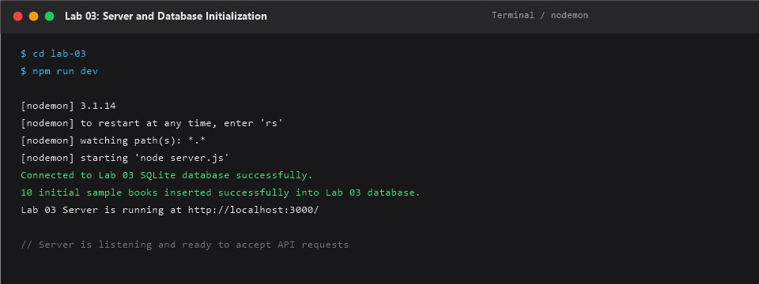

### 2. GET All Books
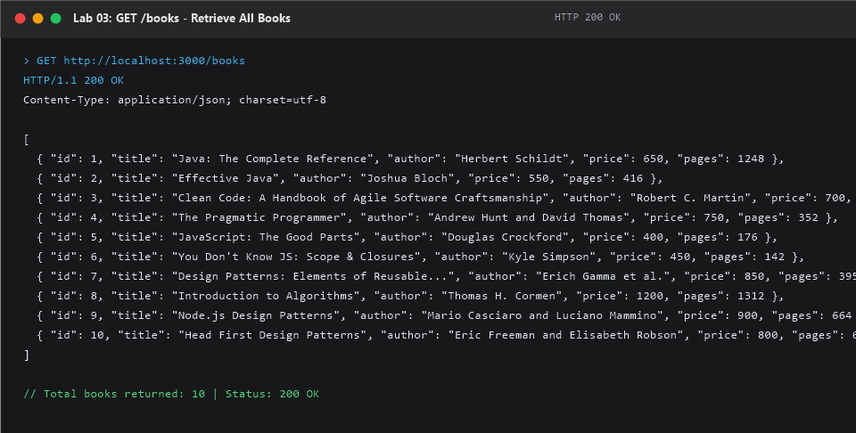

### 3. GET Book by ID
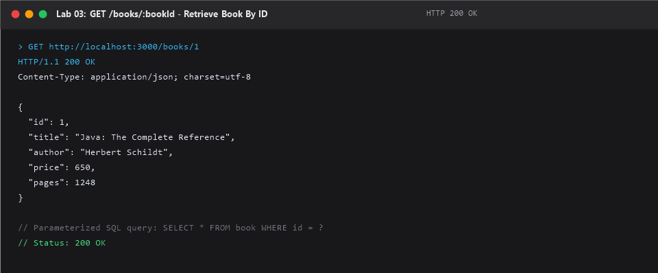

### 4. Search Results (`search_q=java`)
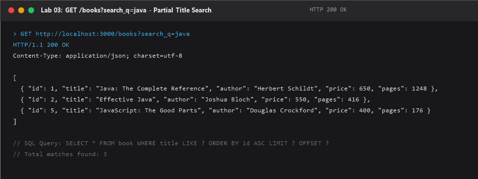

### 5. Sorting Results (`order_by=price&order=ASC`)
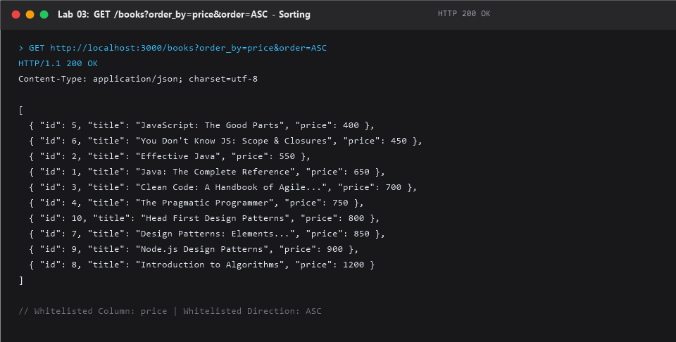

### 6. Pagination Results (`limit=3&offset=2`)
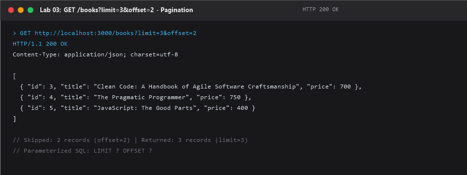

### 7. Price Filtering (`min_price=500&max_price=800`)
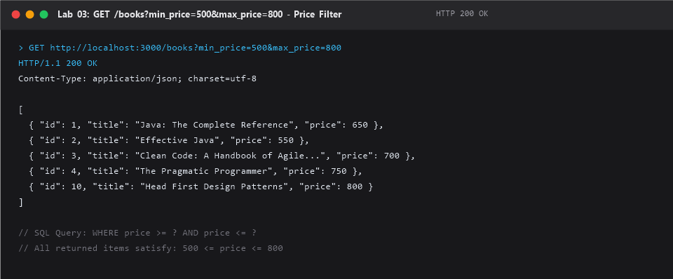

### 8. Successful POST Book
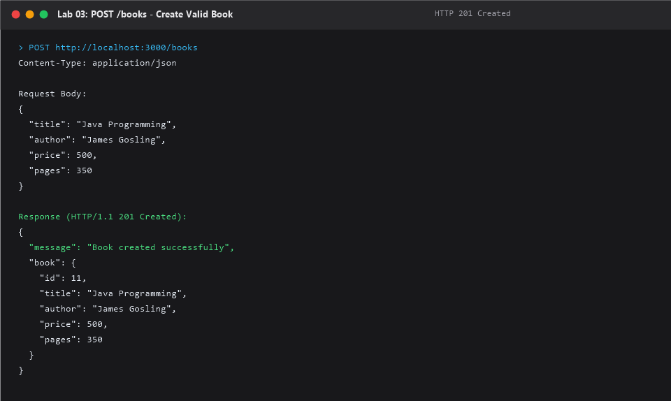

### 9. Successful PUT Book
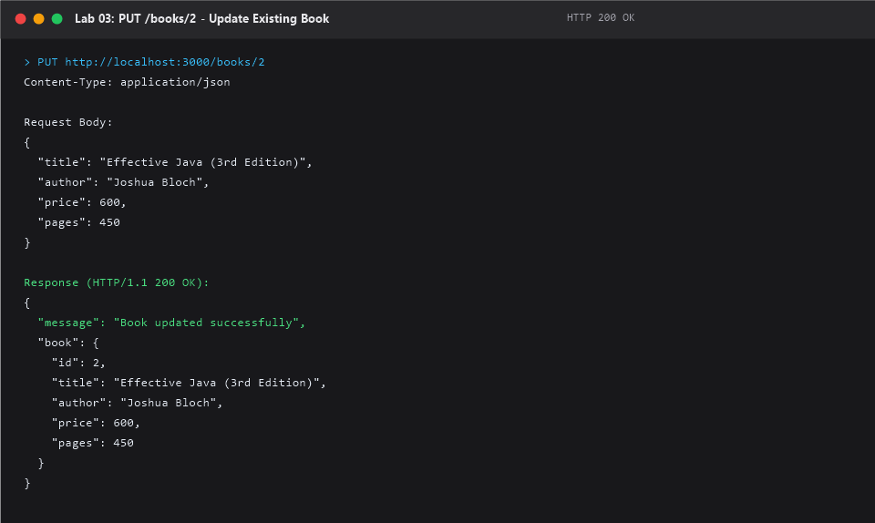

### 10. Successful DELETE Book
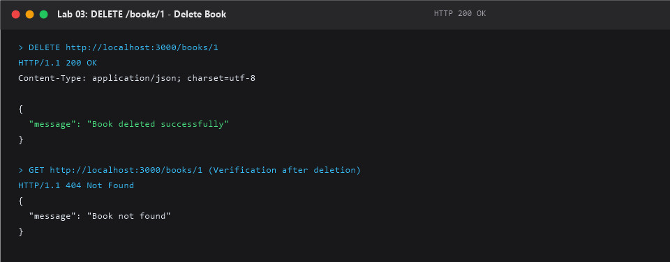

### 11. 400 Bad Request Validation Error
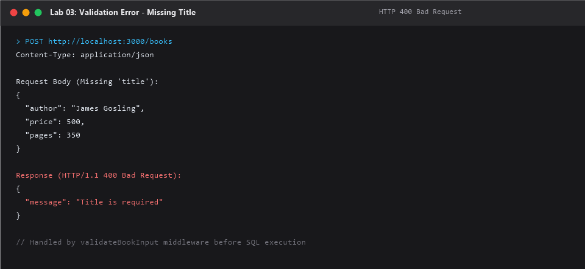

### 12. 404 Not Found Error
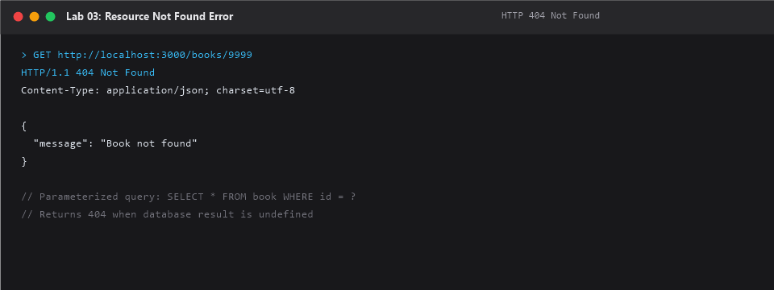

### 13. SQLite Database Records Verification
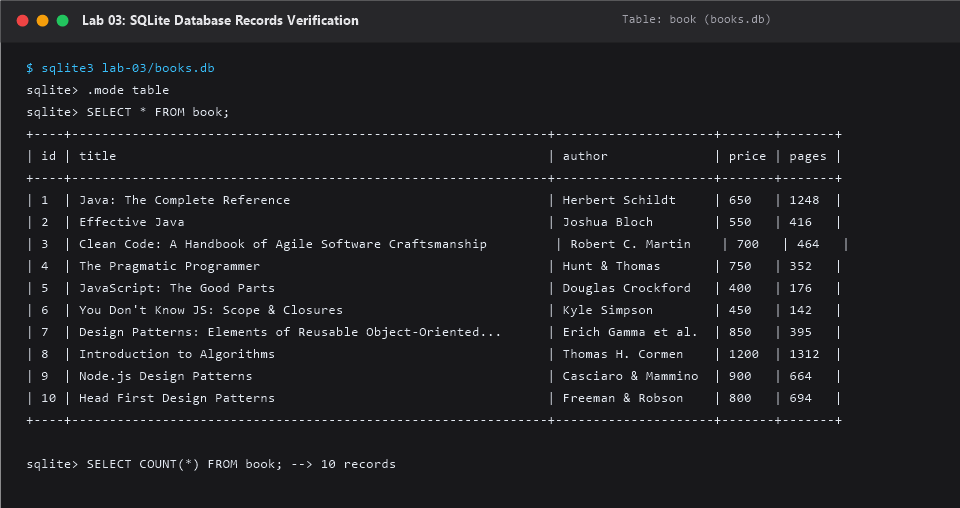

---

## 15. Debugging Problems and Solutions

The [`debugging-exercises/`](./debugging-exercises/) module details four frequent backend issues:

1. **`EADDRINUSE` (Port conflict):**
   - *Cause:* Port 3000 is occupied by another active process.
   - *Fix:* Terminate blocking PID with `taskkill /PID <PID> /F` (Windows) or `kill -9 <PID>` (macOS/Linux), or pass dynamic `PORT=3001 node server.js`.
2. **`MODULE_NOT_FOUND` (Wrong import path):**
   - *Cause:* Typo in relative path or missing package in `node_modules/`.
   - *Fix:* Verify relative path with `path.join(__dirname, ...)` or install via `npm install <package>`.
3. **`SQLITE_ERROR: no such table` (Table-name typo):**
   - *Cause:* Querying `books` (plural) when the schema created `book` (singular).
   - *Fix:* Align query strings with `CREATE TABLE` definitions in `database.sql`.
4. **Missing `await` on Database Call:**
   - *Cause:* Assigning `open(...)` without `await` yields a pending `Promise`, leading to `TypeError: db.all is not a function`.
   - *Fix:* Ensure asynchronous database initializations and queries use `await` inside an `async` function.

Detailed explanations are available in [`debugging-exercises/DEBUGGING.md`](./debugging-exercises/DEBUGGING.md).

---

## 16. Problems Faced and Solutions

1. **Problem: SQL Injection vulnerability in dynamic ORDER BY clauses.**
   - *Issue:* SQL prepared statement placeholders (`?`) only work for values, not table or column identifiers (`ORDER BY ?` does not work in SQL).
   - *Solution:* Implemented a strict whitelist array (`ALLOWED_ORDER_BY = ['id', 'title', 'author', 'price', 'pages']`). If the user passes an unapproved column, the API immediately rejects the request with HTTP `400 Bad Request`.

2. **Problem: Multiple simultaneous query filters (search, price range, sorting, pagination).**
   - *Issue:* Hardcoding SQL queries fails when users pass arbitrary combinations of filters.
   - *Solution:* Built a dynamic query accumulator using a `conditions` array and a matching `queryParams` array, joining them with `' AND '` to safely construct the `WHERE` clause.

3. **Problem: Preventing duplicate sample seed data on server restart.**
   - *Issue:* Restarting the server repeatedly ran `INSERT` statements, ballooning the table with duplicate records.
   - *Solution:* Added a pre-flight query `SELECT COUNT(*) AS count FROM book;`. Sample data is only inserted if the count is strictly `0`.

---

## 17. Deployment Considerations

- **Platform Port Binding:** The application uses `process.env.PORT || 3000` to allow hosting environments to inject dynamic ports.
- **SQLite Persistence on Cloud Platforms (Render / Railway):** SQLite stores data in a local file (`books.db`). Modern cloud container platforms use ephemeral file systems where local files are wiped during redeployments or container sleep cycles.
- **Production Solution:** To achieve true persistence with SQLite on Render or Railway, a persistent volume/disk must be attached. Alternatively, enterprise production environments migrate from SQLite to client-server database systems such as PostgreSQL or MySQL.

---

## 18. Conclusion

Lab 03 successfully expanded our Node.js and Express backend capabilities from basic CRUD routes to advanced RESTful API development. By implementing SQL partial matching, identifier whitelisting, multi-criteria filtering, server-side pagination, strict input validation, and practical error debugging, we created a secure, reliable, and production-ready web service.

