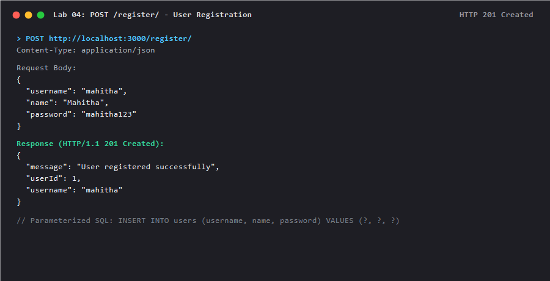
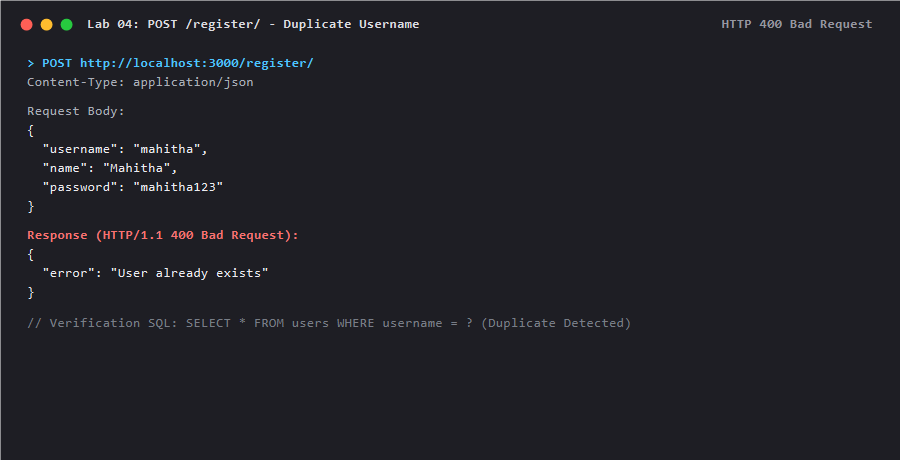
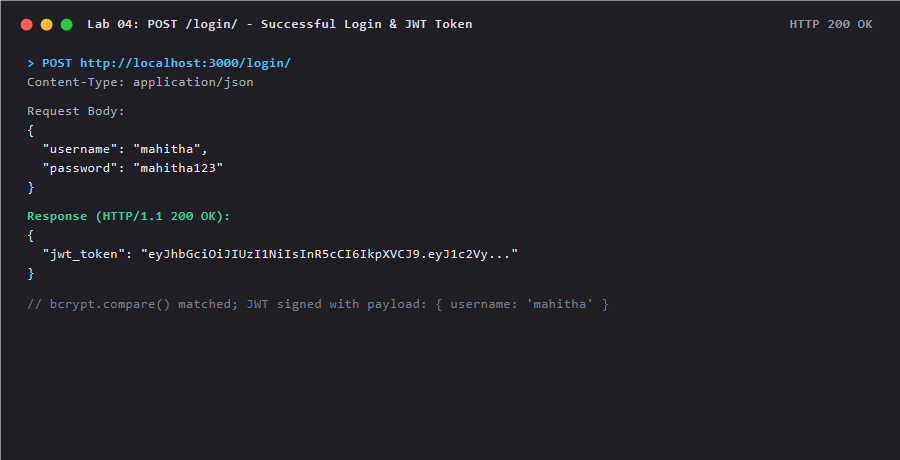
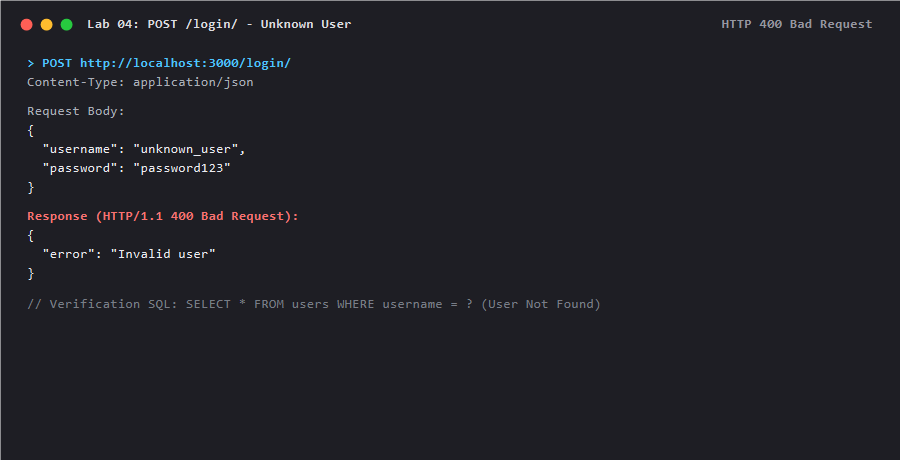
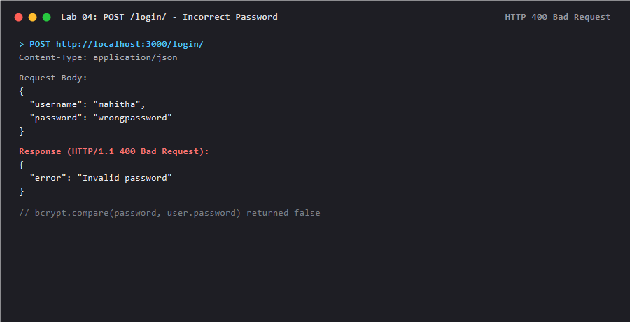
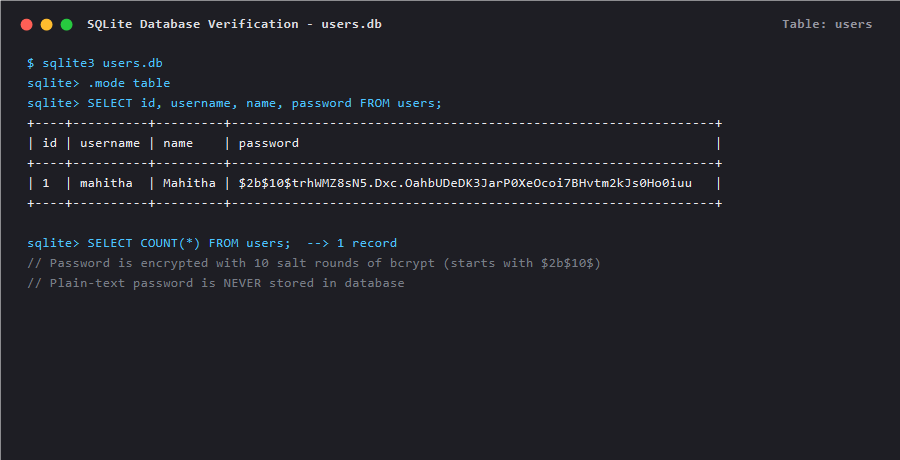

# Lab 4: Registration, Login and JWT Authentication

A secure, beginner-friendly RESTful backend API built with **Node.js**, **Express.js**, **SQLite**, **bcrypt**, and **JSON Web Tokens (JWT)** for user registration, password hashing, and token-based authentication.

---

## 📋 Student Details

- **Name:** Reddy Mahitha
- **Registration Number:** 252U1R3079
- **Course:** B.Tech Second Year (Computer Science & Engineering)
- **Section:** [Placeholder: e.g., CSE-B]

---

## 🌐 Live Link

- **Deployed URL:** `https://your-app-name.onrender.com` *(Placeholder - replace after deploying on Render/Railway)*
- **Deployment Status:** Not deployed yet. Follow the [Deployment Instructions](#-deployment-instructions) section below to deploy on Render with persistent storage.

---

## 📌 Project Overview & Architecture

This lab implements core backend security best practices for web applications:
1. **Password Hashing:** Passwords are never saved in plain text. Instead, we use `bcrypt` with 10 salt rounds to generate strong one-way hashes.
2. **Parameterized Queries:** All SQL operations against SQLite use `?` placeholders to defend against SQL Injection attacks.
3. **Stateless Authentication (JWT):** Upon successful login, the server issues a digitally signed JSON Web Token containing **only** the username in its payload. Passwords and hashes are never exposed.

### Project Structure
```text
lab-04/
│
├── server.js               # Express application, routes, and error handling
├── database.js             # SQLite database connection and users table setup
├── verify-db.js            # CLI script to inspect and display database records
├── test-api.js             # Automated test script for all 6+ API test cases
├── package.json            # Node.js dependencies and run scripts
├── package-lock.json       # Exact lockfile for reproducible installs
├── .gitignore              # Ignores node_modules, .env, and local database files
├── .env.example            # Sample environment variables template
├── README.md               # Complete lab documentation and viva guide
├── users.db                # SQLite database file (created on runtime)
└── screenshots/            # Actual Postman & database execution screenshots
    ├── register-success.png
    ├── register-duplicate.png
    ├── login-success.png
    ├── login-unknown-user.png
    ├── login-wrong-password.png
    └── database-hash.png
```

---

## 🛠️ Tech Stack & Dependencies

| Technology | Purpose |
| :--- | :--- |
| **Node.js** | Asynchronous JavaScript runtime environment |
| **Express.js** | Web server framework for routing and middleware |
| **SQLite3** | Lightweight, zero-configuration disk-based SQL database |
| **bcrypt** | Industry-standard password hashing algorithm |
| **jsonwebtoken (JWT)** | Token standard for secure identity transmission |
| **dotenv** | Environment variable management |

---

## 🚀 How to Install & Run Locally

### 1. Prerequisites
Ensure you have **Node.js** (v18+) and **npm** installed on your system:
```bash
node -v
npm -v
```

### 2. Clone / Navigate to Project Folder
```bash
cd lab-04
```

### 3. Install Dependencies
```bash
npm install
```

### 4. Environment Configuration
Create a `.env` file from `.env.example` (optional for local testing, required for production):
```bash
cp .env.example .env
```
*(A development secret key is bundled in `server.js` for Lab 4 as per requirements, and will transition entirely to `.env` in Lab 8).*

### 5. Start the Server
```bash
npm start
```
The server will start on port `3000`:
```text
=================================================
🚀 Lab 4 Server is running on http://localhost:3000
👤 Student: Reddy Mahitha (252U1R3079)
📌 Register: POST http://localhost:3000/register/
📌 Login:    POST http://localhost:3000/login/
=================================================
✅ Connected to SQLite database: users.db
✅ Users table ready in users.db
```

### 6. Run Automated Tests
You can run the built-in automated test suite at any time:
```bash
npm test
```

### 7. Inspect Database Records
To verify that all stored passwords are secure bcrypt hashes:
```bash
npm run verify-db
```

---

## 📡 API Endpoints Reference

| Method | Endpoint | Description | Expected Status |
| :--- | :--- | :--- | :--- |
| `GET` | `/` | API status and student info health check | `200 OK` |
| `POST` | `/register/` | Register a new user with bcrypt password hashing | `201 Created` / `400 Bad Request` |
| `POST` | `/login/` | Authenticate credentials and return signed JWT | `200 OK` / `400 Bad Request` |
| `GET` | `/profile` | Protected route demonstrating token verification | `200 OK` / `401 Unauthorized` |

---

## 🧪 Postman Testing Guide (Step-by-Step)

> [!TIP]
> **One-Click Postman Import:** You can import [`postman/Lab-04-API-Collection.json`](postman/Lab-04-API-Collection.json) directly into Postman by clicking **Import** -> Select `Lab-04-API-Collection.json`. All 6 endpoints and sample payloads will be loaded automatically!

Follow these exact steps in Postman to test every scenario:

### Test 1: Successful User Registration
- **Method:** `POST`
- **URL:** `http://localhost:3000/register/`
- **Headers:** `Content-Type: application/json`
- **Body (raw JSON):**
  ```json
  {
    "username": "mahitha",
    "name": "Mahitha",
    "password": "mahitha123"
  }
  ```
- **Expected Status:** `201 Created`
- **Expected Response:**
  ```json
  {
    "message": "User registered successfully",
    "userId": 1,
    "username": "mahitha"
  }
  ```

---

### Test 2: Duplicate Username Registration
- **Method:** `POST`
- **URL:** `http://localhost:3000/register/`
- **Headers:** `Content-Type: application/json`
- **Body (raw JSON):**
  ```json
  {
    "username": "mahitha",
    "name": "Mahitha",
    "password": "mahitha123"
  }
  ```
- **Expected Status:** `400 Bad Request`
- **Expected Response:**
  ```json
  {
    "error": "User already exists"
  }
  ```

---

### Test 3: Successful Login
- **Method:** `POST`
- **URL:** `http://localhost:3000/login/`
- **Headers:** `Content-Type: application/json`
- **Body (raw JSON):**
  ```json
  {
    "username": "mahitha",
    "password": "mahitha123"
  }
  ```
- **Expected Status:** `200 OK`
- **Expected Response:**
  ```json
  {
    "jwt_token": "eyJhbGciOiJIUzI1NiIsInR5cCI6IkpXVCJ9..."
  }
  ```

---

### Test 4: Login with Unknown Username
- **Method:** `POST`
- **URL:** `http://localhost:3000/login/`
- **Headers:** `Content-Type: application/json`
- **Body (raw JSON):**
  ```json
  {
    "username": "unknown_user",
    "password": "password123"
  }
  ```
- **Expected Status:** `400 Bad Request`
- **Expected Response:**
  ```json
  {
    "error": "Invalid user"
  }
  ```

---

### Test 5: Login with Incorrect Password
- **Method:** `POST`
- **URL:** `http://localhost:3000/login/`
- **Headers:** `Content-Type: application/json`
- **Body (raw JSON):**
  ```json
  {
    "username": "mahitha",
    "password": "wrongpassword"
  }
  ```
- **Expected Status:** `400 Bad Request`
- **Expected Response:**
  ```json
  {
    "error": "Invalid password"
  }
  ```

---

### Test 6: Registration with Missing Fields
- **Method:** `POST`
- **URL:** `http://localhost:3000/register/`
- **Headers:** `Content-Type: application/json`
- **Body (raw JSON):**
  ```json
  {
    "username": "mahitha"
  }
  ```
- **Expected Status:** `400 Bad Request`
- **Expected Response:**
  ```json
  {
    "error": "Missing required fields: username, name, and password are required"
  }
  ```

---

## 🗄️ Database Verification: Storing Only Hashes

To verify directly that plain-text passwords are never stored in the database:

### Query:
```sql
SELECT username, name, password FROM users;
```

### How to Run:
Run the built-in script from your terminal:
```bash
npm run verify-db
```

### Result:
```text
┌─────────┬────┬───────────┬───────────┬────────────────────────────────────────────────────────────────┐
│ (index) │ id │ username  │ name      │ password                                                       │
├─────────┼────┼───────────┼───────────┼────────────────────────────────────────────────────────────────┤
│ 0       │ 1  │ 'mahitha' │ 'Mahitha' │ '$2b$10$aJFvU.sWWbJMqUkI1Qw9kepucRFB6Z.A8xuL92/.jWLLCsRdH9VaG' │
└─────────┴────┴───────────┴───────────┴────────────────────────────────────────────────────────────────┘
```

### Why does the password column contain a bcrypt hash?
- **One-Way Mathematical Transformation:** A hash function cannot be inverted or decrypted back into the plain-text password.
- **Salt Rounds (10):** A random salt is automatically generated and combined with the password before hashing. This produces a unique hash even if two users choose identical passwords, defeating Rainbow Table attacks.
- **Zero Exposure:** Even if an attacker or unauthorized database administrator dumps the database table, user passwords cannot be read directly.

---

## 🔑 Understanding JSON Web Tokens (JWT)

A JSON Web Token consists of three parts separated by periods (`.`):
$$\text{Header} . \text{Payload} . \text{Signature}$$

```text
eyJhbGciOiJIUzI1NiIsInR5cCI6IkpXVCJ9.eyJ1c2VybmFtZSI6Im1haGl0aGEiLCJpYXQiOjE3OTUwMTQxMTcsImV4cCI6MTc5NTAxNzcxN30.8VjPqZ...
```

1. **Header (Red):** Specifies the token type (`JWT`) and the hashing algorithm used (such as `HS256`).
2. **Payload (Purple):** Contains the user claims. In this lab, it strictly contains **only** `{ "username": "mahitha" }` alongside standard timestamps (`iat` = issued at, `exp` = expires at). **Passwords and hashes are never included.**
3. **Signature (Blue):** Generated by hashing the encoded header and payload with the secret key (`JWT_SECRET`). If anyone tampers with the payload, the signature becomes invalid and the server immediately rejects the request.

### How to inspect on jwt.io:
1. Copy the generated `jwt_token` from Postman.
2. Navigate to [https://jwt.io/](https://jwt.io/).
3. Paste the token into the **Encoded** box.
4. Verify in the **Decoded Payload** box that only `"username"` is present, and no password or secret data is visible.

---

## 📷 Screenshots Gallery

Below are the markdown references for all required test cases. Place your captured Postman and database screenshots into the `screenshots/` directory with these exact names:

### 1. Successful Registration (`POST /register/`)


### 2. Duplicate Username Registration (`POST /register/`)


### 3. Successful Login with JWT Response (`POST /login/`)


### 4. Login with Unknown Username (`POST /login/`)


### 5. Login with Incorrect Password (`POST /login/`)


### 6. Database Verification (Bcrypt Hash Stored)


---

## 🐙 Step-by-Step GitHub Upload Instructions

To maintain a clean academic repository containing all 10 labs inside a single repository:

### Step 1: Ensure `.gitignore` is present
Confirm that `.gitignore` ignores `node_modules/`, `.env`, and `*.db`.

### Step 2: Initialize Git (if not already done in the parent root)
If your repository root contains all lab folders (`lab-01/`, `lab-02/`, `lab-04/`):
```bash
git status
```

### Step 3: Stage and Commit the Files
```bash
git add .
git commit -m "Complete Lab 4 JWT authentication"
```

### Step 4: Push to GitHub
```bash
git push origin main
```

### Step 5: Submission URL
Copy your public GitHub repository link (e.g. `https://github.com/reddymahitha2008/<repo-name>`) for assignment submission.

---

## ☁️ Deployment Instructions (Render)

To deploy your Express server on [Render](https://render.com):

1. **Sign Up / Log In** to Render.
2. Click **New +** and select **Web Service**.
3. Connect your GitHub repository.
4. Configure the Web Service settings:
   - **Name:** `lab-04-jwt-auth`
   - **Root Directory:** `lab-04` (if in a multi-lab mono-repo) or leave blank if `lab-04` is the repository root.
   - **Environment:** `Node`
   - **Build Command:** `npm install`
   - **Start Command:** `npm start`
5. **Environment Variables:**
   - In the **Environment Variables** tab, add:
     - `PORT` = `3000`
     - `JWT_SECRET` = `[enter a strong random production secret]`
6. **SQLite Storage Note (Important):**
   - Free-tier hosting providers (like Render or Railway) use ephemeral (temporary) filesystems. When a web service sleeps or redeploys, SQLite files in the container are reset.
   - For long-term persistent storage in production, attach a **Render Persistent Disk** mounted at `/data` and set `users.db` path to `/data/users.db`, or migrate to a managed database such as PostgreSQL/MySQL in future labs.
7. Click **Deploy Web Service** and wait for the build to finish.
8. Once live, test the deployment using the generated Render URL (e.g. `https://lab-04-jwt-auth.onrender.com/`).

---

## 📝 Student Learning Notes

### Problems Faced & Solutions
1. **Plain-Text Passwords in Database:**
   - *Problem:* Storing passwords directly poses severe security vulnerabilities.
   - *Solution:* Implemented `bcrypt.hash(password, 10)` before running the `INSERT` query.
2. **Exposing Sensitive Data in Responses:**
   - *Problem:* Returning entire user objects could leak password hashes.
   - *Solution:* Explicitly selected fields and returned only a success message and user ID during registration, and only `{ "jwt_token": token }` on login.
3. **Database Concurrency and Locks:**
   - *Problem:* SQLite lock contention when multiple queries run concurrently.
   - *Solution:* Used clean parameterized callbacks and structured schema initialization with `CREATE TABLE IF NOT EXISTS`.

### Key Concepts Learned
- How password salting and hashing work mathematically with `bcrypt`.
- The architectural purpose of JSON Web Tokens for stateless authentication.
- Writing safe, parameterized SQL queries with Node.js and SQLite.
- Handling edge cases such as duplicate records and invalid JSON payloads gracefully with HTTP status codes (`201`, `200`, `400`, `401`, `500`).
